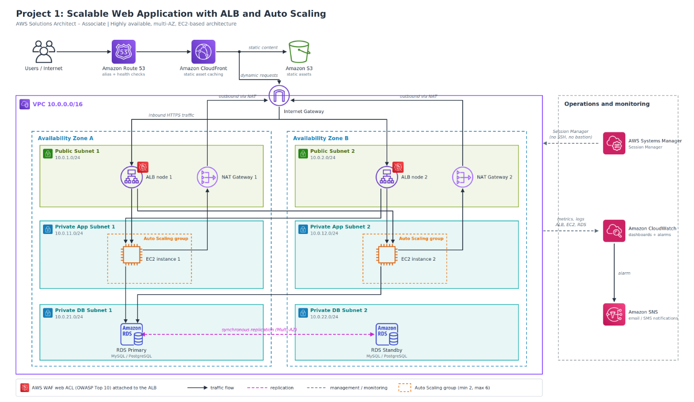
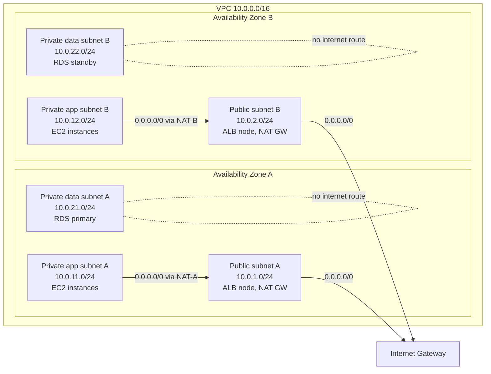
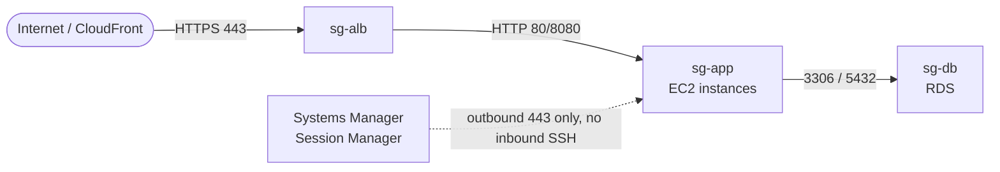
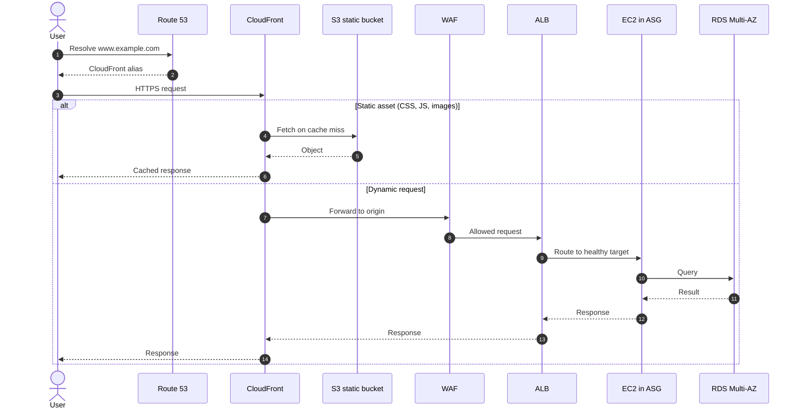
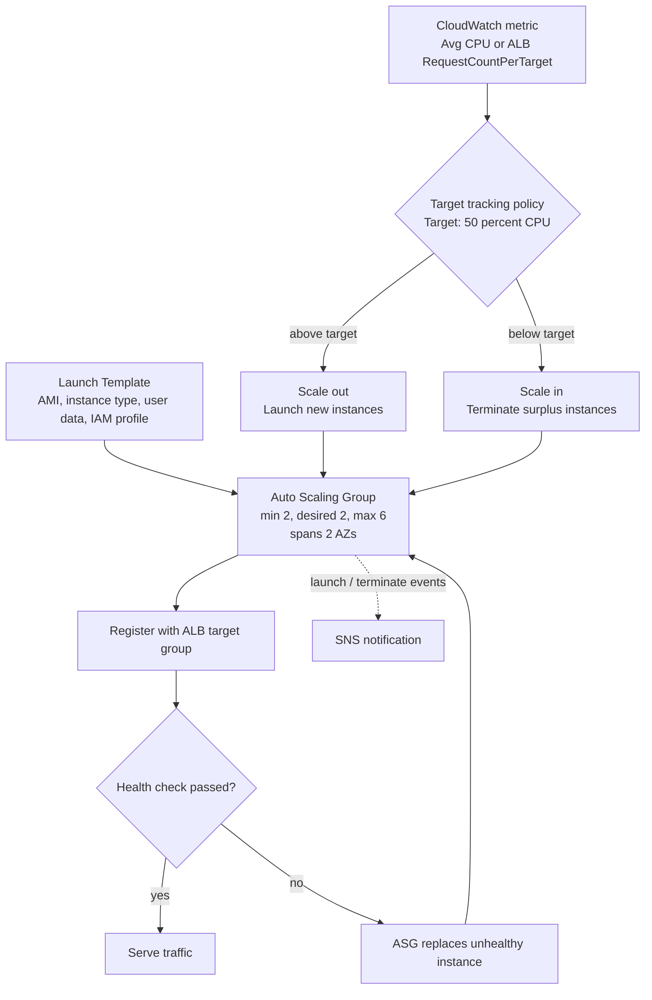
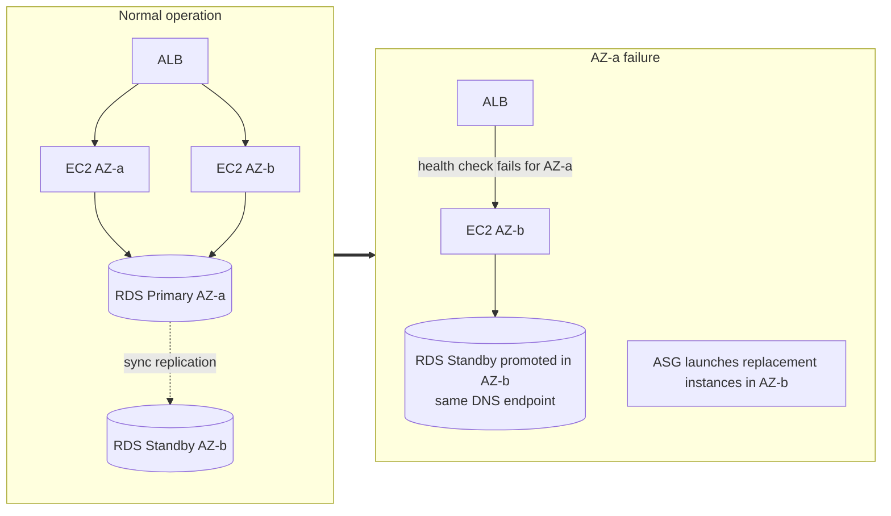
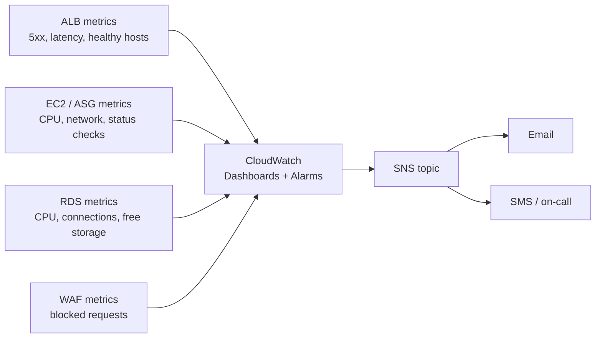

# Project 1: Scalable Web Application with ALB and Auto Scaling

**Track:** AWS Solutions Architect – Associate (Graduation Project)
**Architecture type:** EC2-based

## 1. Overview

Deploy a production-grade web application on AWS using EC2 instances inside a properly architected VPC, with public and private subnets across **two Availability Zones**. High availability and scalability are achieved with an Application Load Balancer (ALB), an Auto Scaling Group (ASG), and a CloudFront distribution that caches static assets. A Multi-AZ RDS instance is the database backend, and **all compute runs in private subnets**.

## 2. Key AWS Services

| Service              | Role in the solution                                            |
| -------------------- | --------------------------------------------------------------- |
| **VPC**              | Public and private subnets, NAT Gateway, Security Groups, NACLs |
| **EC2 + ASG**        | Launch Template, target tracking scaling policies               |
| **ALB + WAF**        | Layer 7 routing, WAF rules for the OWASP Top 10                 |
| **CloudFront**       | Caches static assets, reduces latency                           |
| **RDS Multi-AZ**     | MySQL/PostgreSQL with automated failover                        |
| **Route 53**         | Alias record pointing to the CloudFront/ALB, health checks      |
| **Systems Manager**  | Session Manager for secure, bastion-free instance access        |
| **CloudWatch + SNS** | Dashboards, alarms, and notifications                           |

## 3. Solution Architecture Diagram

High-level view of the full solution:

## 4. Network Layout (VPC, Subnets, Route Tables)

Three subnet tiers per Availability Zone, each with its own route table logic.

| Route table | Associated subnets | Routes                                                |
| ----------- | ------------------ | ----------------------------------------------------- |
| `rt-public` | Public A, Public B | `10.0.0.0/16` → local, `0.0.0.0/0` → Internet Gateway |
| `rt-app-a`  | Private app A      | `10.0.0.0/16` → local, `0.0.0.0/0` → NAT GW A         |
| `rt-app-b`  | Private app B      | `10.0.0.0/16` → local, `0.0.0.0/0` → NAT GW B         |
| `rt-data`   | Private data A, B  | `10.0.0.0/16` → local only                            |

## 5. Security Groups (Layered Access)

Each tier only accepts traffic from the tier directly in front of it.

| Security group | Inbound rule                          | Source                                        |
| -------------- | ------------------------------------- | --------------------------------------------- |
| `sg-alb`       | TCP 443 (and 80 redirect)             | CloudFront managed prefix list or `0.0.0.0/0` |
| `sg-app`       | TCP 80/8080                           | `sg-alb`                                      |
| `sg-db`        | TCP 3306 (MySQL) or 5432 (PostgreSQL) | `sg-app`                                      |

> **No port 22 is open anywhere.** Admin access uses Session Manager through the SSM agent and an IAM instance profile.

## 6. Request Flow

## 7. Auto Scaling Behaviour

## 8. High Availability and Failover

- **Compute:** the ALB stops routing to failed targets, and the ASG launches replacements in the healthy AZ.
- **Database:** RDS Multi-AZ promotes the standby automatically (typically 60–120 seconds); the application keeps using the same endpoint.
- **Egress:** one NAT Gateway per AZ prevents a single AZ failure from cutting off outbound internet for the other.

## 9. Monitoring and Alerting

Suggested alarms:

| Alarm                           | Threshold        | Action                    |
| ------------------------------- | ---------------- | ------------------------- |
| ALB `HTTPCode_Target_5XX_Count` | > 10 in 5 min    | SNS                       |
| ALB `UnHealthyHostCount`        | ≥ 1 for 3 min    | SNS                       |
| ASG average CPU                 | > 70% for 10 min | SNS (plus scaling policy) |
| RDS `CPUUtilization`            | > 80% for 10 min | SNS                       |
| RDS `FreeStorageSpace`          | < 10 GB          | SNS                       |
| WAF blocked requests spike      | anomaly          | SNS                       |

## 10. Implementation Steps

1. **Network:** create the VPC, 6 subnets (public, private-app, private-data × 2 AZs), Internet Gateway, 2 NAT Gateways, and route tables.
2. **Security:** create `sg-alb`, `sg-app`, `sg-db` and NACLs; create an IAM role with `AmazonSSMManagedInstanceCore` for EC2.
3. **Database:** create a DB subnet group and an RDS Multi-AZ instance (MySQL or PostgreSQL) in the private data subnets, with encryption enabled.
4. **Compute:** create a Launch Template (AMI, user data to install and start the app, instance profile) and an Auto Scaling Group across the private app subnets with a target tracking policy.
5. **Load balancing:** create the ALB in the public subnets, a target group with a health check path (e.g. `/health`), and HTTPS listener with an ACM certificate.
6. **Edge protection:** attach a WAF web ACL (AWS Managed Rules: Core rule set, SQLi, Known bad inputs) to the ALB.
7. **CDN:** create an S3 bucket for static assets and a CloudFront distribution with two origins (S3 via Origin Access Control and the ALB), with cache behaviors per path.
8. **DNS:** create a Route 53 alias record pointing to CloudFront and optional health checks.
9. **Operations:** configure Session Manager, CloudWatch dashboard and alarms, and an SNS topic with email subscription.
10. **Test:** load test to trigger scale out, terminate an instance, and reboot RDS with failover to validate resilience.
